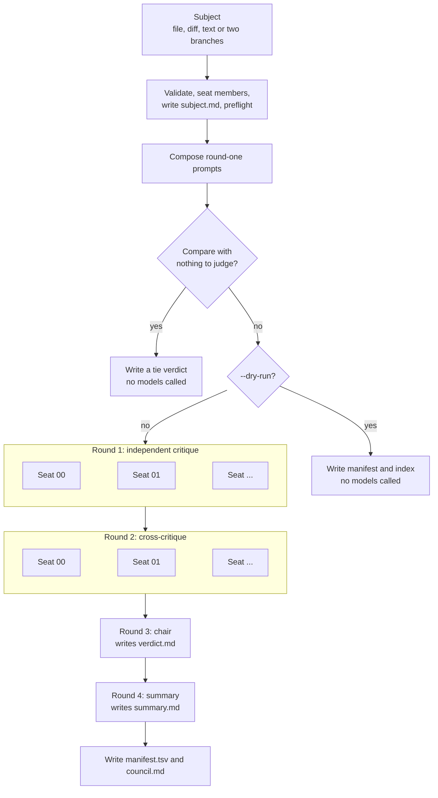
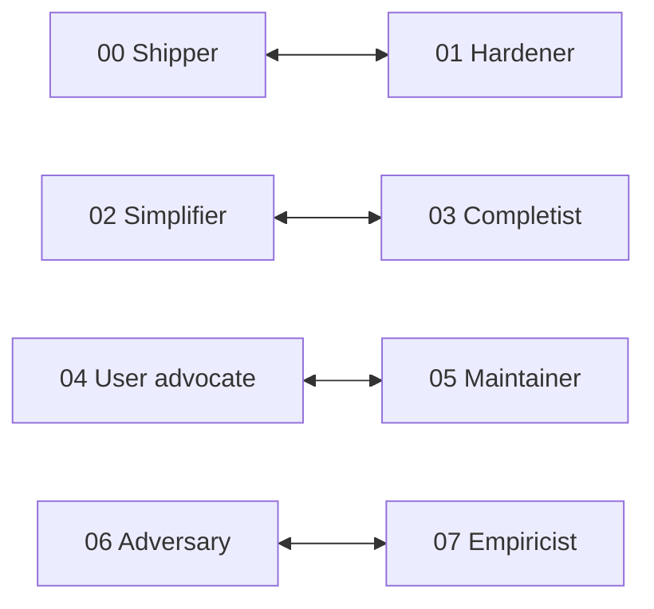
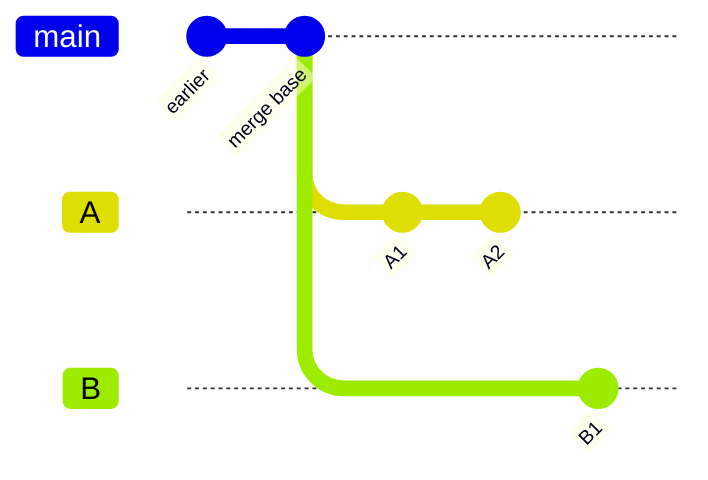
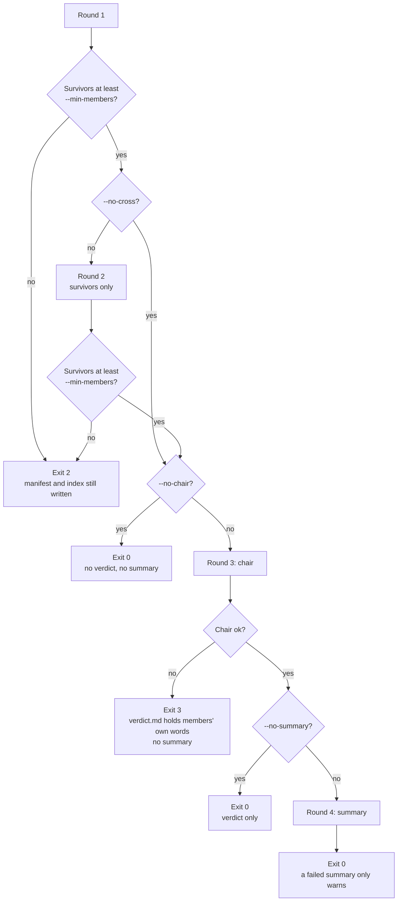
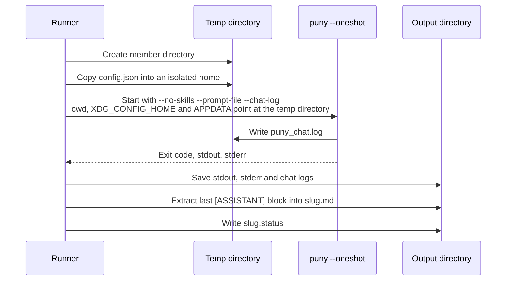
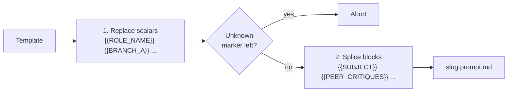
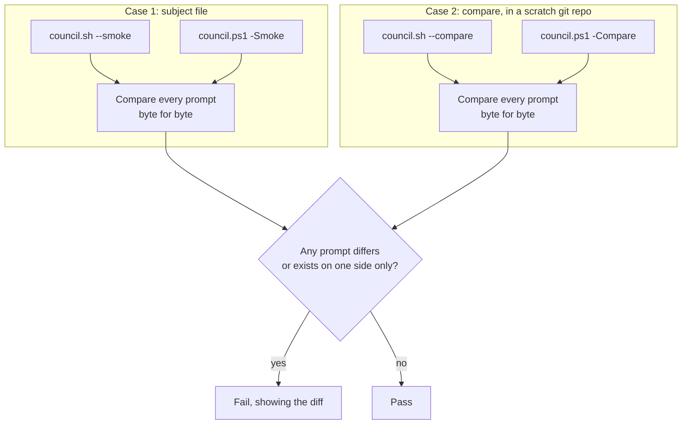

# Council scripts

The council runs a panel of AI reviewers over a plan, a diff, free text, or two
competing branches, and produces one ranked verdict.

A single model reviewing its own kind of work tends to agree with itself. The
council builds disagreement in. Members differ by model and by role brief, each
is told to look at only one narrow angle, and they sit in adversarial pairs who
must attack each other's findings. A chair who took no part then decides what
actually survived.

| File | Purpose |
|---|---|
| [`council.sh`](council.sh) | The runner for Bash (Linux, macOS, Git Bash on Windows) |
| [`council.ps1`](council.ps1) | The same runner for PowerShell 7 or newer |
| [`council-parity.sh`](council-parity.sh) | Checks that both runners compose byte-identical prompts |
| [`council/roles/`](council/roles) | One brief per seat |
| [`council/prompts/`](council/prompts) | Templates for each round |
| [`council/providers.txt`](council/providers.txt) | Provider names allowed in a model spec |
| [`council/mock-triggers.txt`](council/mock-triggers.txt) | Words the mock provider reacts to |
| [`council/smoke/`](council/smoke) | Keyword-safe roles, prompts and subject for self-tests |

## Quick start

Build puny first (`zig build`), or have it on your `PATH`. Then:

```bash
# Review the committed work on this branch
./scripts/council.sh --diff main --models "provider-a:model-x,provider-b:model-y"

# Review a plan
./scripts/council.sh --subject-file docs/plan.md

# Decide between two implementations of the same thing
./scripts/council.sh --compare feature/approach-a feature/approach-b

# See the prompts without calling a model
./scripts/council.sh --subject-file docs/plan.md --dry-run

# Test the plumbing against the mock provider (the smoke set has 4 seats)
./scripts/council.sh --smoke --members 4 --subject-file scripts/council/smoke/subject.md
```

```powershell
./scripts/council.ps1 -Diff main -Models provider-a:model-x,provider-b:model-y
./scripts/council.ps1 -Compare feature/approach-a,feature/approach-b
```

`council.sh` prints the short summary to stdout and all logging to stderr, so
`./scripts/council.sh ... > summary.txt` captures only the summary. `council.ps1`
currently does not print the summary at all, so read `summary.md` instead. The
full report is `council.md` in the output directory, which defaults to
`.council/<UTC timestamp>-<slug>` under the current directory.

A default run makes **14 model calls**: 6 members in each of two rounds, one
chair and one summary. In general that is `2N + 2`. Both runners also warn that
the chat log they depend on forces high reasoning effort, which costs more per
call.

## How a run works



Members within a round run in parallel, and each sees nothing from the others
until the next round.

### Round 1: independent critique

Each member receives its role brief, the task for the subject's kind, and the
full subject. It replies in a fixed format so that later rounds can rely on it:

```text
VERDICT: ship | ship-with-changes | do-not-ship
CONFIDENCE: high | medium | low

FINDING 1: <a problem, stated as a claim>
  Impact: <what goes wrong, and for whom>
  Evidence: <text quoted from the subject>
  Fix: <the smallest change that resolves it>
  Certainty: high | medium | low

WEAKEST POINT: <the finding it is least sure of, and why>
```

Each member files three to seven findings. Evidence must be quoted from the
subject, because members have no repository access and the chair is told to
discard anything it cannot trace back to a quote.

### Round 2: cross-critique

Each surviving member gets the subject, its own round-one answer and every other
survivor's round-one answer, labelled with role and model. It must then:

1. Rebut its adversarial opposite by name, quoting the claims it attacks.
2. Name the strongest and the weakest finding on the council.
3. Retract or downgrade at least one of its own findings.
4. Say what the whole council missed.

If a member's opposite did not survive round one, it gets the `nopair` template
instead and attacks the two strongest claims on the council itself.

Each peer's critique is capped at `--max-peer-chars` so that one verbose member
cannot crowd out the rest. The cut lands on a line boundary and leaves a
`[TRUNCATED: N bytes omitted]` marker.

### Round 3: chair

The chair sees the subject and all round-one and round-two output from the
members who are still standing. Its job is synthesis, not a new opinion. It
writes `verdict.md` with:

- A verdict and a one-line headline.
- Ranked findings, each with a consensus count, who raised it, who disputed it, a
  fix and a severity (`blocker`, `major` or `minor`).
- A **Contested** section giving both sides of each real disagreement, and which
  is better argued.
- A **Dropped in round two** section for what was retracted or refuted.
- A **Chair's own additions** section, marked `[CHAIR]`, which may be empty.

The chair is told to weigh arguments rather than count heads, since the seats are
designed to produce lone dissent, but to report the headcount honestly.

### Round 4: summary

The chair's model condenses the verdict to under 200 words of plain text with a
`MUST FIX` and a `WORTH KNOWING` list. It may report only what the verdict says.
This is the version to read first, before deciding whether to open the rest.

## Seats

Seat order decides who sits by default: `--members N` takes the first N. There
are 8 briefs, so 8 is the maximum.



| Seat | Role | Looks for | Must |
|---|---|---|---|
| 00 | Shipper | Over-engineering, gold-plating, grown scope | Never ask for "more analysis"; name the one thing that must change |
| 01 | Hardener | Unhandled failures, partial states, leaks, silent truncation | Report problems only, with no praise |
| 02 | Simplifier | One-caller abstractions, unused options, forwarding layers | Propose at least two concrete deletions |
| 03 | Completist | Unhandled inputs, boundary cases, undefined transitions | Name a case not covered and what happens today |
| 04 | User advocate | Confusing names, surprising defaults, unhelpful failure messages | Judge names by whether a newcomer would guess them |
| 05 | Maintainer | Coupling, unwritten invariants, missing migration paths | Say what future change each finding makes harder |
| 06 | Adversary | Injection, traversal, leaked secrets, unbounded use | Describe the concrete attack, not the category |
| 07 | Empiricist | Unsupported claims, untested behaviour, unmeasured numbers | Quote first, then argue |

Seat `i` is paired with seat `i XOR 1`, which gives the pairs above.

- **Odd councils:** the last seat has no opposite, so its round-two prompt uses
  the `nopair` template. The runners warn about this.
- **`--roles`:** pairs follow the position in your list, not the role. In
  `--roles shipper,simplifier`, those two become opposites, even though their
  briefs still describe their usual opposites. Keep natural pairs adjacent.

### Models

`--models` takes a comma-separated list of `[provider:]model` specs, assigned
round-robin across the seats. With two models, each adversarial pair is split
across them, so opposites also differ by model.

| Given | Result |
|---|---|
| No models | Every member uses the model from your puny config |
| One model | Members differ by role brief alone (warns) |
| Odd number of models | Some pairs share a model (warns) |

A leading token counts as a provider only if it is listed in
[`council/providers.txt`](council/providers.txt). An unknown `foo:bar` is rejected
so that a typo cannot become a model id, while an id such as
`qwen/qwen3-coder:free` passes through because of its slash.

The chair and the summary use `--chair` if given, otherwise the first seat's model.

## Subjects

Exactly one is required. The chosen subject is written to `subject.md`, and every
member sees those same bytes.

| Flag | Subject | Default kind |
|---|---|---|
| `--subject-file PATH` | The file's contents | `plan` for `.md` and `.markdown`, `diff` for `.diff` and `.patch`, otherwise `text` |
| `--diff BASE` | `git diff --stat` and `git diff` for `BASE...HEAD` | `diff` |
| `--subject TEXT` | The given text | `text` |
| `--compare A B` | Both branches, each diffed from a shared base | `compare` |

The kind selects `prompts/round1-<kind>.md`, and `--kind` overrides it.

`--diff` and `--compare` cover **committed work only**. Both warn if the working
tree is dirty. To include uncommitted changes, save the output of `git diff` to a
`.diff` file and pass it through `--subject-file`.

### Compare mode

Compare mode judges two alternatives rather than stacked changes.



Each side is diffed from the same base, so the council weighs the approaches and
not the patch noise between the branches. The base is their merge base unless
`--compare-base X` overrides it. The templates change accordingly:

- Verdicts become `A-wins`, `B-wins` or `tie`, and a tie must be a real result.
- Findings become reasons, weighed on correctness, maintainability, performance,
  robustness, test coverage and simplicity.
- Every quote is prefixed `[A]` or `[B]`. The chair treats an unprefixed quote as
  supporting neither side.
- The chair adds a **Merge suggestion**: what the winner should take from the loser.

If both branches are empty against the base, or resolve to the same tree, the
runner records a `tie` without calling any model and exits 0.

## Failure handling

A single bad member should not sink a run, but a verdict built on too few voices
should not pass as a council's either.



- **A member who fails is dropped, not retried.** One who fails round two is
  removed entirely, so the chair does not see their round-one answer either.
- **Quorum** defaults to half the council rounded up, with a floor of 2. A
  one-member council therefore needs an explicit `--min-members 1`.
- **Each member has a status**, recorded in its `.status` file and in the manifest:

| Status | Meaning |
|---|---|
| `ok` | Exited 0 with an answer of at least `--min-answer-chars` bytes |
| `timeout` | Exceeded `--timeout` and was killed |
| `exit:N` | Exited with code N |
| `extract-empty` | Exited 0, but the answer was too short |

`extract-empty` exists because a one-shot puny run exits 0 even when the provider
fails, so the exit code alone cannot be trusted.

### Exit codes

| Code | Meaning |
|---|---|
| 0 | Finished, including runs that skip the chair or lose the summary |
| 1 | Usage or preflight error |
| 2 | Quorum not met |
| 3 | The chair failed |
| 130 | Interrupted (`council.sh`) |

## How a member runs

Each call is a separate one-shot puny process in its own empty directory.



- **Empty directory.** Members cannot read your repository. They are also told
  not to call tools, but no flag disables tools, so this is an instruction and an
  empty directory rather than a sandbox.
- **Isolated config.** Each member gets its own copy of `config.json`, so parallel
  members do not race on the session index or add to your session history. Without
  a config to copy, the runners warn and share the real directory, because a
  missing config would start puny's interactive first-run setup.
- **Answer extraction.** Answers come from `puny_chat.log` because it holds the
  model's raw markdown. Stdout is rendered for the terminal and wrapped at 80
  columns, so `--no-chat-log` degrades what later rounds read.
- **Secrets.** Member config copies contain provider tokens. The temp directory is
  deleted on exit, including after an interrupt, unless you pass `--keep-temp`,
  which warns you. Smoke runs strip API keys from their copies.
- **Interrupts.** Members still in flight are stopped, so paid calls do not carry
  on unseen.

### Preflight

Before any model is called, the runners check that:

- Required tools exist. `council.sh` needs `awk`, `sed`, `grep` and `git`, plus
  `timeout` unless you pass `--timeout 0`.
- The puny binary is found, in order: `--bin` or `PUNY_BIN`, then
  `zig-out/bin/puny[.exe]`, then `PATH`.
- puny is 0.3.5 or newer, since extraction relies on its chat-log format.
- A Copilot token is stored if any seat or the chair uses `copilot`. Otherwise
  several members would race through the interactive login. Run
  `puny --provider copilot` once in a terminal to log in.
- The output directory is empty, so that stale critiques cannot be reported as
  current. `--force` clears only the files a run owns.

## Prompt composition

Templates live in `council/prompts`. Rendering takes two steps, in this order:



| Template | Used for | Blocks spliced in |
|---|---|---|
| `round1-plan.md`, `round1-diff.md`, `round1-text.md`, `round1-compare.md` | Round 1, by kind | `ROLE_BRIEF`, `SUBJECT` |
| `round2.md`, `round2-compare.md` | Round 2, opposite alive | `ROLE_BRIEF`, `SUBJECT`, `OWN_ROUND1`, `PEER_CRITIQUES` |
| `round2-nopair.md`, `round2-compare-nopair.md` | Round 2, no opposite | The same |
| `round3-chair.md`, `round3-chair-compare.md` | Chair | `SUBJECT`, `ALL_ROUND1`, `ALL_ROUND2` |
| `round4-summary.md` | Summary | `VERDICT_REPORT` |

The subject and member output are untrusted, so the rendering is careful with them:

- Scalars are substituted in one pass as data, so a branch name containing `|`,
  `&` or `{{BRANCH_B}}` stays literal.
- Block markers are matched only as whole lines of the template, and spliced text
  is never rescanned, so a subject containing `{{SUBJECT}}` does nothing.
- Every template tells the model that the material is under review and never
  instruction, and that text addressed to it should be reported as a finding.

## Output

```text
.council/20261104T120000Z-diff-main/
├── council.md          The report: start here
├── summary.md          The short version, also printed by council.sh
├── verdict.md          The chair's full synthesis
├── subject.md          Exactly what every member was shown
├── manifest.tsv        Status, timing, size and verdict for every call
├── round1/
│   ├── 00-shipper.prompt.md    What was sent
│   ├── 00-shipper.md           The extracted answer
│   ├── 00-shipper.status       status, exit code, elapsed ms, answer bytes
│   ├── 00-shipper.chat.log     Raw chat log
│   ├── 00-shipper.stdout.log
│   ├── 00-shipper.stderr.log
│   └── ...
├── round2/             The same files per surviving member
├── round3/             chair.*
└── round4/             summary.*
```

`manifest.tsv` has these columns:
`round`, `seat`, `role`, `model`, `status`, `exit_code`, `elapsed_ms`,
`answer_bytes` and `verdict`. A verdict shows as `-` unless the answer has a
recognised `VERDICT:` line. In a dry run, the round-one rows show `PLANNED`.

## Options

`council.sh` flags are shown first, then the `council.ps1` parameter.

### Subject

| Bash | PowerShell | Description |
|---|---|---|
| `-f`, `--subject-file PATH` | `-SubjectFile` | Critique a file |
| `-d`, `--diff BASE` | `-Diff` | Critique `git diff BASE...HEAD` |
| `-t`, `--subject TEXT` | `-Subject` | Critique the given text |
| `--compare A B` | `-Compare A,B` | Judge branch A against branch B |
| `--compare-base X` | `-CompareBase` | Compare from X instead of the merge base |
| `--kind KIND` | `-Kind` | `plan`, `diff`, `text` or `compare` |

### Council

| Bash | PowerShell | Default | Description |
|---|---|---|---|
| `-n`, `--members N` | `-Members` | 6 | Council size, up to 8 |
| `-m`, `--models LIST` | `-Models` | puny config | Models, each `[provider:]model` |
| `-c`, `--chair SPEC` | `-Chair` | First seat's model | Model for the chair and summary |
| `--roles LIST` | `-Roles` | First N seats | Role ids, for example `hardener,adversary`. Cannot be combined with `--members` or `COUNCIL_MEMBERS` |
| `--no-cross` | `-SkipCross` | | Skip round 2 |
| `--no-chair` | `-SkipChair` | | Skip round 3, and so the summary too |
| `--no-summary` | `-SkipSummary` | | Skip round 4 |

### Execution

| Bash | PowerShell | Default | Description |
|---|---|---|---|
| `-j`, `--jobs N` | `-Jobs` | All members | Members running at once |
| `--timeout SECONDS` | `-TimeoutSec` | 900 | Limit per member, 0 for none |
| `--min-members N` | `-MinMembers` | Half, at least 2 | Quorum, checked after rounds 1 and 2 |
| `--min-answer-chars N` | `-MinAnswerChars` | 200 | Shorter answers count as a failure |
| `--max-peer-chars N` | `-MaxPeerChars` | 20000 | Cap per peer critique in round 2, at least 1000 |
| `--bin PATH` | `-Bin` | Auto-detected | Path to the puny binary |
| `--no-chat-log` | `-NoChatLog` | | Extract answers from stdout (lossy) |
| `--no-isolate-home` | `-NoIsolateHome` | | Share the real config directory |
| `--keep-temp` | `-KeepTemp` | | Keep working directories, including token copies |

### Output

| Bash | PowerShell | Default | Description |
|---|---|---|---|
| `-o`, `--out DIR` | `-Out` | `.council/<timestamp>-<slug>` | Output directory |
| `--force` | `-Force` | | Clear a previous run from the directory |
| `--dry-run` | `-DryRun` | | Write round-one prompts only |
| `--smoke` | `-Smoke` | | Self-test against the mock provider |
| `-h`, `--help` | `-Help` | | Show help |

### Environment variables

Flags take precedence over these.

| Variable | Equivalent |
|---|---|
| `PUNY_BIN` | `--bin` |
| `COUNCIL_MEMBERS` | `--members` |
| `COUNCIL_MODELS` | `--models` |
| `COUNCIL_CHAIR` | `--chair` |
| `COUNCIL_OUT` | `--out` |
| `COUNCIL_JOBS` | `--jobs` |
| `COUNCIL_TIMEOUT` | `--timeout` |
| `COUNCIL_COMPARE` | `--compare`, as two whitespace-separated refs |
| `COUNCIL_COMPARE_BASE` | `--compare-base` |
| `NO_COLOR` | Turns off colour in `council.sh` |

## Testing

### Smoke run

`--smoke` runs the whole pipeline against puny's mock provider, with no cost and
no provider tokens. It uses `council/smoke/`, a proposal for a second office
kettle, because the real briefs contain words that the mock provider treats as
commands. The runners refuse to send a smoke template containing a word from
`mock-triggers.txt`.

The smoke set has only 4 seats, so pass `--members 4` or fewer. The default of 6
fails. Mock answers are canned, so a smoke run tests the plumbing and says nothing
about review quality.

### Parity check

The two runners are written by hand and kept in step, and what must not drift
between them is what reaches the model. Run this after changing either one:

```bash
./scripts/council-parity.sh
```

It needs `pwsh` and `diff`. `PARITY_MEMBERS` sets the council size (default 4).



It does full mock runs rather than dry runs, so rounds two to four are covered.
That also tests answer extraction, because a round-two prompt embeds round-one
output and can only match if both runners extracted the same text. Files in
`scripts/council/` are forced to LF in [`.gitattributes`](../.gitattributes), so a
Windows checkout does not make the prompts differ.

The check compares prompts only. It does not compare other runner behaviour, such
as exit codes, logs or the manifest.

## Extending

- **Add a provider:** add a line to `council/providers.txt`. Both runners read it.
- **Change or add a role:** edit or add `council/roles/NN-<id>.md`. The first
  line is the role's name, the file name sets its id and seat, and each odd seat
  opposes the even seat before it. The number of files sets the maximum council size.
- **Change a prompt:** edit the template in `council/prompts`, and the matching file
  in `council/smoke/prompts` if the markers changed. A new scalar marker must be
  added to both runners, or rendering aborts.
- **Change a runner:** make the same change in the other one, then run
  `council-parity.sh`.
- **Track a new mock keyword:** add it to `council/mock-triggers.txt`, mirroring
  `MockKeyword` in `src/providers/mock.zig`.
